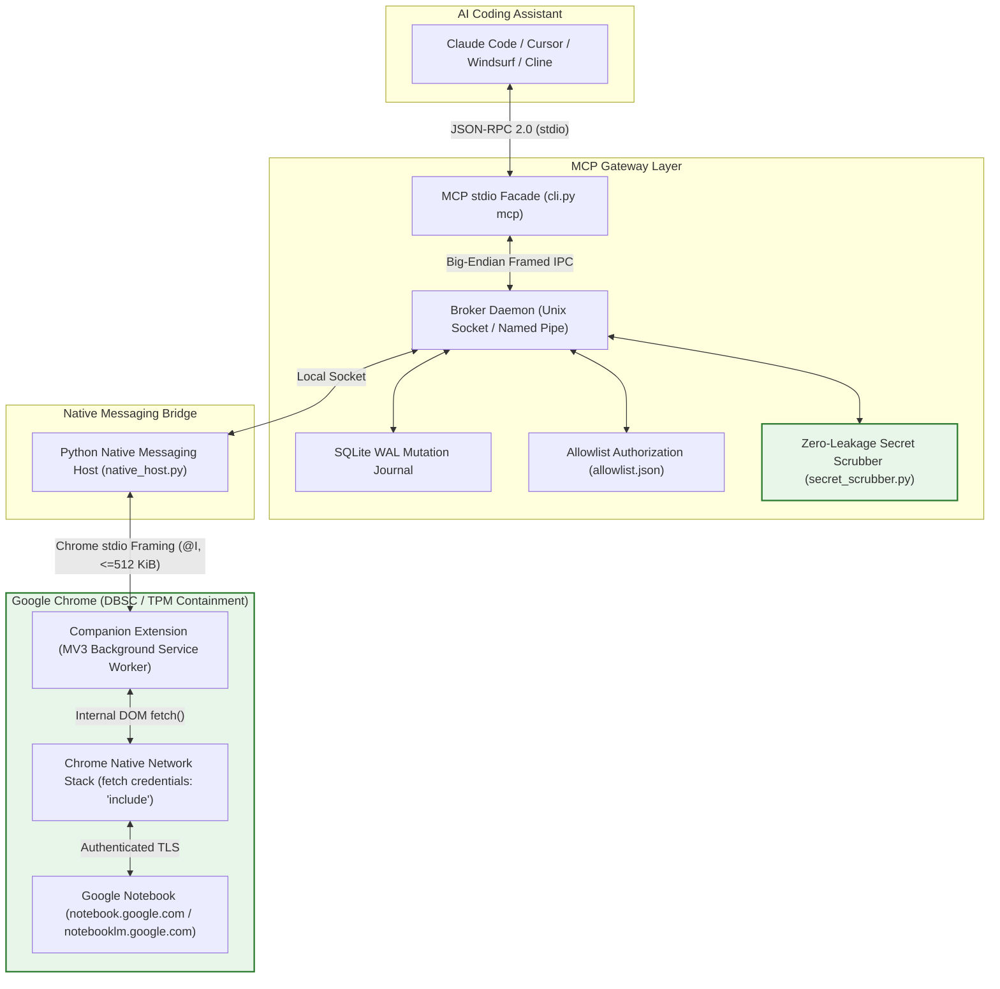

# Google Notebook MCP Gateway

<div align="center">

[](https://www.python.org/downloads/)
[](https://github.com/wdeldaybytebuster/google-notebook-mcp/actions/workflows/ci.yml)
[](https://github.com/wdeldaybytebuster/google-notebook-mcp/wiki)
[](LICENSE)
[](https://modelcontextprotocol.io)
[](docs/security.md)
[](CONTRIBUTING.md)

**A secure, zero-credential-export Model Context Protocol (MCP) gateway connecting AI coding agents to your private [Google Notebook](https://notebook.google.com) knowledge bases (formerly NotebookLM).**

[Quickstart](#quickstart) • [Wiki](https://github.com/wdeldaybytebuster/google-notebook-mcp/wiki) • [Supported Clients](#client-configuration) • [Tool Reference](#mcp-tool-reference) • [Documentation](docs/) • [Security Model](docs/security.md)

</div>

---

## Overview

**Google Notebook MCP** brings the grounded reasoning, multi-document synthesis, and citation capabilities of **Google NotebookLM** directly into your AI development workflow (**Claude Code, Cursor, Windsurf, Cline, Antigravity IDE, Zed**).

Unlike traditional API wrappers or unofficial scrapers that ask you to paste session cookies into configuration files, this gateway operates under a strict **Zero-Credential Export** architecture:
- All upstream Google requests execute **inside Google Chrome's native network process** via a Manifest V3 companion extension.
- Google session cookies (`SID`, `HSID`, `SSID`), CSRF tokens (`SNlM0e`), and hardware **Device Bound Session Credentials (DBSC)** never leave Chrome's native memory.
- Credentials are **never written to disk, never sent across local IPC sockets, and never visible to AI client prompt logs or transcripts**.

---

## Architecture



---

## Key Features

- **9 Production MCP Tools**: Grounded natural-language Q&A with Unicode citation spans, source cataloging, note creation/listing/deletion, and file ingestion.
- **ADR-011 Interactive Session Lock**: Enforces single-notebook locking per session, preventing accidental cross-notebook queries or modifications.
- **Project Directory Binding (`.notebook_mcp.json`)**: Seamlessly binds local workspaces to their designated NotebookLM notebook with an interactive in-chat confirmation handshake.
- **Scotty 3-Step Resumable Uploads**: Upload PDFs, Markdown, Word documents, and text files directly into NotebookLM with automatic offset resumption and $\le 512\text{ KiB}$ IPC slicing.
- **Conservative Mutation Journaling**: SQLite WAL state machine guarantees zero duplicate writes and freezes ambiguous requests upon network disconnection.
- **Cross-Platform**: Built-in support for **Linux**, **macOS**, and **Windows** (including Windows Named Pipes and automatic path length bounds).

---

## Quickstart

### 🚀 Zero-Friction Automated Onboarding (Recommended)

Run the autonomous onboarding orchestrator directly from the repository root:

```bash
git clone https://github.com/wdeldaybytebuster/google-notebook-mcp.git
cd google-notebook-mcp

# Run the 6-stage autonomous onboarding wizard
python3 install_and_onboard.py

# Or via the CLI if installed:
gemini-notebook-mcp onboard
```

The orchestrator automatically:
1. Detects your compatible Chromium browser (bypassing ChromeOS Garcon bridges and configuring Wayland flags).
2. Registers the Chrome Native Messaging Host manifests across global and profile scopes.
3. Starts the background Policy Broker daemon.
4. Injects the companion extension via CDP (with guided fallback for Chrome 137+).
5. Detects your Google Sign-In state on `notebook.google.com`.
6. Discovers all your notebooks and interactively seeds `allowlist.json` and `.notebook_mcp.json`.

---

### Manual Step-by-Step Setup

#### 1. Install

```bash
git clone https://github.com/wdeldaybytebuster/google-notebook-mcp.git
cd google-notebook-mcp

# Using pip:
pip install -e .

# Or using uv:
uv sync
```

#### 2. Register Chrome Native Messaging Host

Automatically registers the gateway bridge with Chrome:

```bash
gemini-notebook-mcp install
```

#### 3. Load Companion Extension in Chrome

1. Open Chrome and navigate to `chrome://extensions`.
2. Enable **Developer mode** (toggle in the top-right).
3. Click **Load unpacked** and select the `src/extension/` directory from this repository.
4. Copy the generated **Extension ID** (e.g., `abcdefghijklmnop...`). If it differs from the default, run:
   ```bash
   gemini-notebook-mcp install --extension-id <COPIED_EXTENSION_ID>
   ```

#### 4. Launch Gateway & Dedicated Browser

```bash
gemini-notebook-mcp launch
```

#### 5. Authorize Your Notebooks

Run the interactive allowlist wizard to choose which notebooks your AI agents can access:

```bash
gemini-notebook-mcp allowlist seed
```

---

## Client Configuration

Add the gateway to your favorite AI coding environment:

### Claude Code
Run in your terminal:
```bash
claude mcp add gemini-notebook -- python3 -m mcp_gateway.cli mcp
```

### Cursor (`.cursor/mcp.json` or Global Settings)
```json
{
  "mcpServers": {
    "gemini-notebook": {
      "command": "python3",
      "args": ["-m", "mcp_gateway.cli", "mcp"],
      "env": {
        "MCP_BROKER_SOCKET": "/tmp/notebooklm-mcp-broker.sock",
        "UV_THREADPOOL_SIZE": "3"
      }
    }
  }
}
```

### Windsurf (`~/.codeium/windsurf/mcp_config.json`)
```json
{
  "mcpServers": {
    "gemini-notebook": {
      "command": "python3",
      "args": ["-m", "mcp_gateway.cli", "mcp"],
      "env": {
        "MCP_BROKER_SOCKET": "/tmp/notebooklm-mcp-broker.sock"
      }
    }
  }
}
```

### Cline / Roo Code (`cline_mcp_settings.json`)
```json
{
  "mcpServers": {
    "gemini-notebook": {
      "command": "python3",
      "args": ["-m", "mcp_gateway.cli", "mcp"],
      "disabled": false,
      "autoApprove": []
    }
  }
}
```

*For detailed instructions on other clients (Zed, Antigravity IDE, Neovim), see the [Client Configuration Guide](docs/client-configuration.md).*

---

## MCP Tool Reference

| Tool | Type | Key Inputs | Description |
| :--- | :--- | :--- | :--- |
| `select_notebook` | Session | `notebook_id` or `title`, `save_for_project` | Locks session to a single notebook and binds local project config. |
| `list_notebooks` | Read | `page_size`, `cursor` | Lists allowlisted notebooks and returns active project binding status. |
| `get_notebook_metadata` | Read | `notebook_id` (auto-bound) | Fetches full metadata, source counts, and timestamps. |
| `list_sources` | Read | `page_size`, `cursor` | Extracts ingested sources and readiness states (`PROCESSING`, `READY`, `FAILED`). |
| `query_notebook` | Q&A | `question`, `request_key`, `source_ids` | Streams grounded Q&A with normalized Unicode citation offsets. |
| `add_source` | Write | `source`, `idempotency_key`, `wait_until_ready` | Ingests URLs, Google Drive files, pasted text, or local binary documents. |
| `create_note` | Write | `title`, `content`, `idempotency_key` | Creates a new user note journaled in SQLite. |
| `list_notes` | Read | `page_size`, `cursor` | Returns user notes with upstream schema anomaly detection. |
| `delete_note` | Write | `note_id`, `idempotency_key` | Deletes a user note by ID with pre-flight identity assertion. |

*Full schema parameters and error envelopes are documented in the [Tools Reference](docs/tools-reference.md).*

---

## Project-Level Notebook Binding

When working inside a project repository, the gateway can automatically remember which NotebookLM knowledge base belongs to that project:

1. When calling `select_notebook`, setting `save_for_project: true` (the default) creates `.notebook_mcp.json` in your project root.
2. At the start of a chat, the AI assistant calls `list_notebooks`, discovers your project setting, and performs a conversational handshake:
   > *"This project is configured to use notebook **'Project Docs'**. Would you like to use this notebook, or select another from your allowlist?"*
3. Once confirmed, your session is locked and protected against accidental cross-notebook tampering.

---

## Documentation

- **[GitHub Wiki](https://github.com/wdeldaybytebuster/google-notebook-mcp/wiki)**: Comprehensive online wiki with interactive quickstarts, client guides, and FAQs.
- **[Getting Started Guide](docs/getting-started.md)**: Full walkthrough for Linux, macOS, and Windows.
- **[Client Configuration](docs/client-configuration.md)**: Setup guides for all major AI coding agents.
- **[Tools Reference](docs/tools-reference.md)**: Complete parameter reference, types, and error envelopes.
- **[Troubleshooting & FAQs](docs/troubleshooting.md)**: Diagnosing native messaging, permissions, and platform quirks.
- **[Security Architecture](docs/security.md)**: Deep dive into TPM/DBSC containment and secret scrubbing.
- **[Architecture Decision Records](docs/architecture.md)**: The 17 core architectural invariants (ADR-001 through ADR-017).
- **[GitHub Launch Completion Report](docs/github-launch-completion-report.md)**: Full project ledger and security audit from the public repository launch.

---

## Contributing

Contributions, bug reports, and suggestions are welcome! Please read our [Contributing Guide](CONTRIBUTING.md) and [Code of Conduct](CODE_OF_CONDUCT.md) before opening a pull request.

---

## Security Vulnerability Reporting

If you discover a potential security vulnerability, please refer to our [Security Policy](SECURITY.md) to report it responsibly.

---

## License

This project is licensed under the **Apache License 2.0**. See the [LICENSE](LICENSE) file for details.
