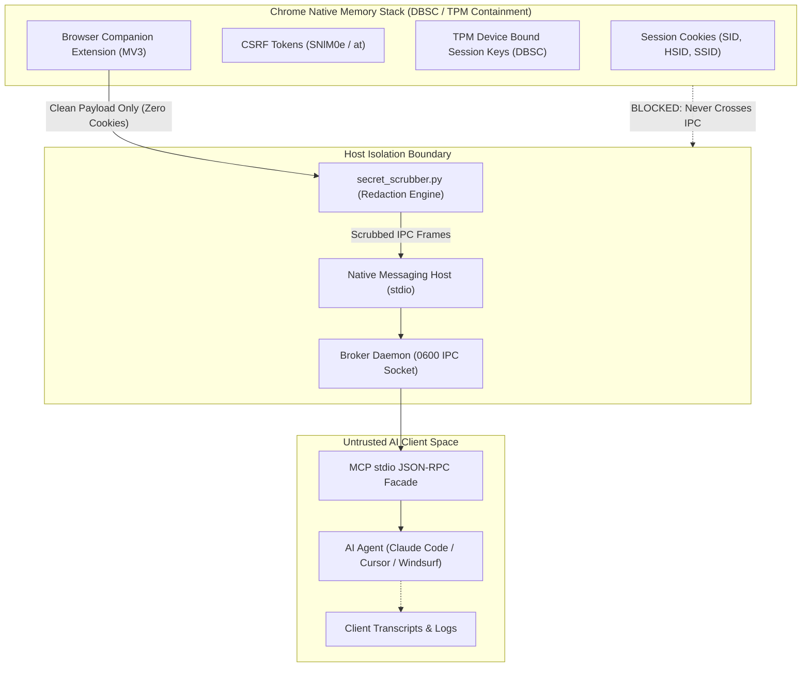

# Security Architecture & Threat Model

The **Google Notebook MCP Gateway** is engineered under a strict **Zero-Credential Export** philosophy. This document explains the security boundaries, runtime containment mechanisms, and defensive invariants protecting user data.

---

## Core Security Invariants

---

## 1. Zero-Credential Export (DBSC / TPM Containment)

### The Threat
Standard web scrapers and unauthorized API bridges extract browser session cookies (`SID`, `HSID`, `SSID`) or OAuth bearer tokens (`ya29.*`) and store them in plain-text configuration files, memory dumps, or agent log transcripts. If an AI agent logs its tool requests, your permanent Google credentials could be leaked to model providers or third-party observability platforms. Furthermore, modern Google accounts utilize **Device Bound Session Credentials (DBSC)**, which bind session tokens to hardware TPM cryptographic keys that cannot leave the browser process.

### The Defense
1. **In-Browser Execution**: All HTTP network requests to `notebook.google.com` are executed **inside Chrome's main network stack** using `fetch()` with credentials mode `include`.
2. **Zero Cookie Extraction**: The Chrome companion extension never inspects, accesses, or serializes cookie jars. Cookies remain inside Chrome's native C++ network process.
3. **Hardware Key Isolation**: DBSC authentication handshakes occur transparently inside Chrome, requiring no key export.
4. **Mandatory Secret Scrubbing**: All IPC frames passing from the browser companion into the native messaging host must pass through `secret_scrubber.py`. Any accidental token patterns matching Google OAuth tokens, bearer authorization headers, or cookie strings are automatically replaced with `[REDACTED_SECRET]`.

---

## 2. Conservative Mutation Journaling

### The Threat
In distributed systems, a network timeout or connection reset during an `add_source` or `create_note` request leaves the state ambiguous: did the server process the mutation before disconnecting, or did it fail? Blindly retrying mutations leads to duplicate notes or duplicate source ingestions.

### The Defense
The gateway implements an SQLite Write-Ahead Logging (WAL) Finite State Machine (FSM):
$$\text{PREPARED} \longrightarrow \text{SENT} \longrightarrow \text{CONFIRMED} \mid \text{REJECTED}$$

1. **Deterministic Request Keys**: Every mutation requires a client-supplied `idempotency_key` or `request_key`.
2. **State Freeze on Ambiguity**: If a connection disconnects while in the `SENT` state, the mutation transitions immediately to `UNKNOWN`.
3. **Replay Prohibition**: Automatic replay of `UNKNOWN` records is strictly blocked until active reconciliation proves whether the upstream resource was created.

---

## 3. ADR-011 Interactive Session Locking

### The Threat
An AI coding agent with broad tool access might accidentally query or mutate notes in unrelated personal notebooks.

### The Defense
1. **Interactive Session Lock**: Operations require selecting a target notebook via `select_notebook`.
2. **Deny-by-Default (Allowlist Enforcement)**: Only notebooks explicitly approved in `~/.config/notebooklm-mcp-bridge/allowlist.json` can be selected.
3. **Single-Notebook Immutability**: Once an MCP session is locked to a notebook, calling `select_notebook` with a different notebook ID returns a `SESSION_LOCKED` error. Switching notebooks requires restarting the MCP client process.
4. **Project Directory Binding**: Working directories persist their chosen notebook in `.notebook_mcp.json`. The AI assistant double-checks with the user before assuming a target notebook.

---

## 4. Closed Tool Surface Defense

All MCP JSON schemas enforce:
- `additionalProperties: false` (JSON Schema)
- `extra="forbid"` (Pydantic v2)

Any extraneous parameter passed by an LLM (such as hallucinated prompt flags or malformed structures) immediately triggers an `INVALID_ARGUMENT` failure envelope before any IPC or network dispatch occurs.
