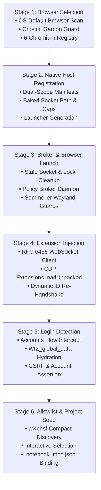

# Zero-Friction Onboarding Architecture & Guide

The **Zero-Friction Onboarding Orchestrator** (`install_and_onboard.py` / `gemini-notebook-mcp onboard`) is an autonomous 6-stage state machine designed to bootstrap the Google Notebook MCP Gateway with zero manual browser configuration, zero token copying, and zero third-party Python dependencies.

---

## 🎯 Architectural Overview



---

## 🔬 In-Depth Stage Breakdown

### Stage 1: OS Default Browser Detection & 6-Browser Registry Selector

1. **OS Detection Mechanism:**
   - **Linux:** Queries `xdg-settings get default-web-browser` and inspects `$BROWSER`.
   - **macOS:** Queries `LSHandlers` registry via `defaults read com.apple.LaunchServices/com.apple.launchservices.secure`.
   - **Windows:** Queries `HKCU\Software\Microsoft\Windows\Shell\Associations\UrlAssociations\https\UserChoice`.
2. **The 6-Browser Compatibility Register:**
   Matches the detected binary against the 6 tested Chromium browsers:
   `google-chrome-beta`, `google-chrome`, `chromium`, `brave`, `edge`, `edge-beta`.
3. **The Crostini Garcon Guard:**
   On ChromeOS Linux (Crostini), the default browser handler is often `garcon-url-handler`. Garcon routes URLs to the host ChromeOS browser outside the container. The host ChromeOS browser cannot reach the container's `/tmp/notebooklm-mcp-broker.sock` and cannot load unpacked extensions from Crostini disk paths.
   The orchestrator detects Garcon, issues a warning, and prompts the user to select an installed native Linux Chromium binary (defaulting to `/usr/bin/google-chrome-beta`).

---

### Stage 2: Dual-Scope Native Messaging Host Registration

Chrome Native Messaging requires a JSON manifest (`com.mcp.gemini.broker.json`) pointing to the native messaging launcher.

1. **Deterministic Extension ID Computation:**
   Computes candidate 32-character extension IDs directly from `manifest.json` and directory path hashing (hex letters `a-p`).
2. **Dual-Scope Manifest Placement:**
   Writes the manifest to both:
   - **Global Scope:** `~/.config/<browser>/NativeMessagingHosts/` (or OS equivalent in Registry/Application Support).
   - **Isolated Profile Scope:** `~/.config/notebooklm-mcp-bridge/chrome-profile/NativeMessagingHosts/`.
3. **Self-Contained Launcher Wrapper:**
   Because Chrome spawns the native host directly without terminal environment variables, the orchestrator generates a launcher script (`native_host_launcher.py` or `.cmd` on Windows) that explicitly bakes in:
   ```python
   os.environ.setdefault("MCP_BROKER_SOCKET", "<resolved_socket_path>")
   os.environ.setdefault("NOTEBOOKLM_MCP_SOCKET", "<resolved_socket_path>")
   os.environ.setdefault("UV_THREADPOOL_SIZE", "3")
   os.environ.setdefault("OMP_NUM_THREADS", "3")
   ```

---

### Stage 3: Background Broker Daemon & Isolated Browser Launch

1. **Stale Socket & Lock Unlinking:**
   - Probes the broker socket. If the socket exists but `connect()` raises `ConnectionRefusedError`, it unlinks the stale socket file before spawning the broker.
   - Cleans up stale Chrome `SingletonLock`, `SingletonSocket`, and `SingletonCookie` symlinks in `chrome-profile` to prevent crash-recovery deadlocks.
2. **Developer Mode Pre-Seeding:**
   - Pre-seeds `chrome-profile/Default/Preferences` with `{"extensions": {"ui": {"developer_mode": true}}}` so Developer mode is already turned ON when the extensions management page opens.
3. **Resource Capping:**
   Applies `UV_THREADPOOL_SIZE=3`, `OMP_NUM_THREADS=3`, `NODE_OPTIONS="--max-old-space-size=1024 --max-semi-space-size=128"`, and file descriptor limit 65536.
4. **Crostini Sommelier Wayland Guards:**
   If running under ChromeOS Wayland (`/usr/bin/sommelier`), passes `--no-sandbox --no-zygote --disable-dev-shm-usage` to prevent Wayland compositor crashes.
5. **Initial Launch Target:**
   Launches the browser directly at `chrome://extensions` (rather than the login page) so the companion extension is verified before authentication occurs.

---

### Stage 4: Extension Injection & Verification Gate

Chrome 137+ enterprise and security policies frequently ignore the `--load-extension` command-line flag. The orchestrator enforces an **Extension-First Verification Gate**:

1. **Pure Standard-Library RFC 6455 WebSocket Client:**
   Implemented purely in `socket`, `struct`, and `hashlib` with zero third-party packages:
   - **Continuation Frame Reassembly:** Correctly buffers fragmented payloads (`FIN == 0` with opcode `0x1`, followed by opcode `0x0` continuation frames until `FIN == 1`).
   - **Masked Pong Replies:** Responds to server `Ping` (`0x9`) frames with client-masked `Pong` (`0x8A`) frames echoing ping payloads per RFC 6455 §5.5.3.
2. **CDP `Extensions.loadUnpacked` & 1-Click Guided Fallback:**
   Attempts automated injection via CDP. If the browser restricts CDP extension loading, the orchestrator copies the absolute extension path to the system clipboard (`wl-copy`, `xclip`, `xsel`, `pbcopy`, `clip`) and prompts the user to click **Load unpacked** (1 click) and paste the path.
3. **Dynamic Extension ID Sync:**
   Detects `service_worker.js` registration in `/json`. If Chrome assigns an extension ID different from candidate hashes, updates `allowed_origins` in `com.mcp.gemini.broker.json` and immediately re-triggers `Extensions.loadUnpacked` so `service_worker.js` connects without delay.

---

### Stage 5: NotebookLM Navigation & `WIZ_global_data` Hydration Poll

1. **Automated Navigation:**
   Only after Stage 4 confirms the companion extension's service worker is active, the orchestrator automatically navigates the browser tab to `https://notebook.google.com/` (reloading or navigating existing pages via CDP `Page.navigate`, or opening `/json/new`). Because the extension is already running, content scripts attach immediately upon page load.
2. **Google Accounts Intercept:**
   Inspects open tabs via `http://127.0.0.1:9222/json/list`. If the user is on `accounts.google.com` (`/signin`, `/ServiceLogin`, `/v3/signin`), it pauses and alerts the user in the terminal to complete sign-in.
3. **In-Page Hydration Assertion:**
   Executes in-page `Runtime.evaluate` on `notebook.google.com`:
   ```javascript
   Boolean(window.WIZ_global_data && window.WIZ_global_data.SNlM0e) &&
   Boolean(window.WIZ_global_data.oM1Kwf || window.WIZ_global_data.FdrFJe)
   ```
4. **Account Email Binding:**
   Extracts `window.WIZ_global_data.oM1Kwf` (active Google email) to enforce the Pre-Flight Account Identity Guard (P-03).

---

### Stage 6: Live Notebook Discovery & Interactive Allowlist Seeding

1. **Live Wire `wXbhsf` Fallback:**
   Queries the broker IPC socket (`{"action": "list_notebooks"}`). If the native port is handshaking, falls back to executing `wXbhsf` inside the browser tab via `fetch()` with `credentials: "include"`.
2. **Wire Safety & Compact Extraction:**
   Uses Google's verified `[null, 1, null, [2]]` view enum with `source-path=/` and `hl=en`. Parses `wrb.fr` records inside the browser and returns only compact `[{id, title}]` arrays over WebSocket, avoiding buffering multi-megabyte raw responses.
3. **Interactive Allowlist Configuration:**
   Displays a numbered table of notebooks. Allows selection:
   - Specific notebooks by number (e.g., `1,3`)
   - `all` for all discovered notebooks
   - Custom UUID or notebook URL
4. **Project Working Directory Binding:**
   Writes `allowlist.json` with restricted permissions (`0o600`) and automatically writes or updates `.notebook_mcp.json` with the selected project default notebook.

---

## ⚙️ CLI Reference & Automation Flags

The orchestrator supports comprehensive automation flags:

```bash
python3 install_and_onboard.py [OPTIONS]
# or
gemini-notebook-mcp onboard [OPTIONS]
```

| Flag | Type | Description |
| :--- | :--- | :--- |
| `--browser` | String | Force specific browser (`google-chrome-beta`, `google-chrome`, `chromium`, `brave`, `edge`). |
| `--non-interactive` | Flag | Run headlessly without terminal prompts; defaults to all notebooks and auto-selects browser. |
| `--skip-launch` | Flag | Register manifests and configure without launching browser or daemon. |
| `--port` | Integer | Remote debugging port for CDP (default: `9222`). |
| `--socket-path` | Path | Explicit path for Policy Broker Unix domain socket. |
| `--verbose` | Flag | Enable debug-level diagnostic output on stderr. |
